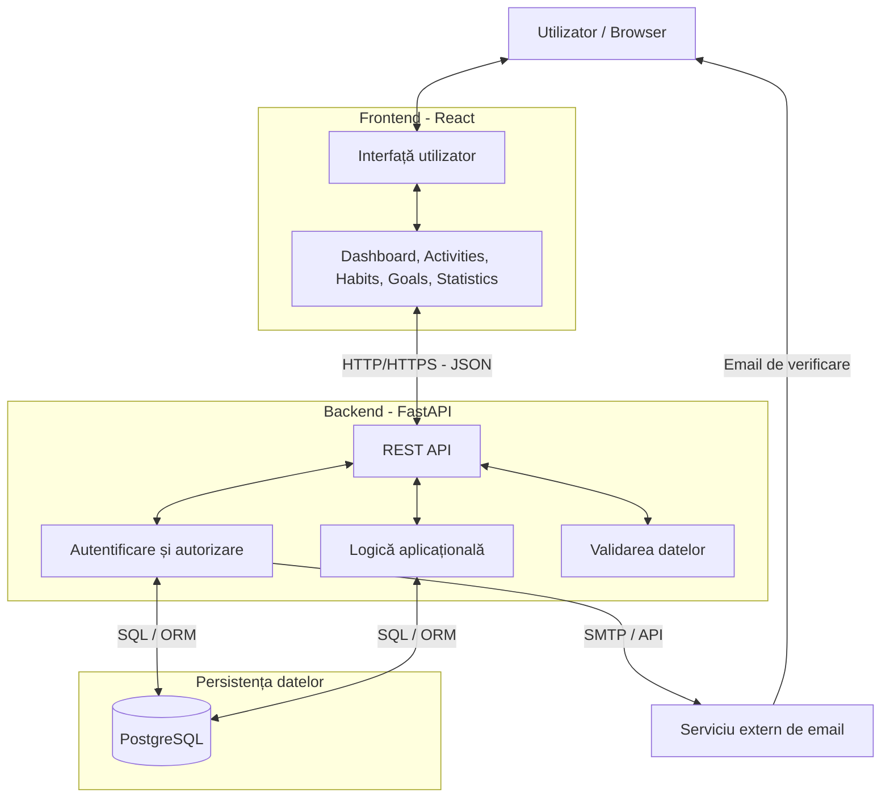

# Arhitectura aplicației – WellTrack

## 1. Descriere generală

WellTrack utilizează o arhitectură client-server, organizată în trei componente principale:

- **Frontend (React):** gestionează interfața și interacțiunea cu utilizatorul.
- **Backend (FastAPI):** implementează API-ul REST, autentificarea, validarea datelor și logica aplicației.
- **Baza de date (PostgreSQL):** asigură stocarea persistentă a informațiilor.

Comunicarea dintre frontend și backend se realizează prin cereri HTTP/HTTPS, folosind formatul JSON. Backend-ul comunică direct cu PostgreSQL pentru citirea și modificarea datelor.

Aplicația integrează și un serviciu extern de email pentru verificarea conturilor.

## 2. Diagrama arhitecturii

## 3. Componentele aplicației

### 3.1. Frontend – React

**Responsabilități:**
- Afișarea paginilor și componentelor interfeței.
- Gestionarea formularelor și validarea preliminară a datelor.
- Transmiterea cererilor către API-ul FastAPI.
- Afișarea activităților, obiceiurilor, obiectivelor și statisticilor.
- Gestionarea navigării și a stării interfeței.
- Adaptarea interfeței pentru desktop și dispozitive mobile.

**Tehnologii:** React, JavaScript, HTML5, CSS3.

### 3.2. Backend – FastAPI

**Responsabilități:**
- Expunerea endpoint-urilor REST.
- Autentificarea și autorizarea utilizatorilor.
- Gestionarea sesiunilor și verificarea emailului.
- Implementarea operațiilor CRUD.
- Validarea datelor primite.
- Calcularea progresului obiectivelor și a statisticilor.
- Importul și exportul datelor în format CSV.
- Verificarea drepturilor de acces la resurse.

**Tehnologii:** Python, FastAPI.

### 3.3. Baza de date – PostgreSQL

PostgreSQL va stoca informațiile necesare funcționării aplicației.

**Tabele principale:**

| Tabel | Rol |
|---|---|
| `users` | Conturile utilizatorilor |
| `sessions` | Sesiunile de autentificare |
| `activity_types` | Tipurile de activități |
| `activities` | Activitățile înregistrate |
| `habits` | Obiceiurile utilizatorilor |
| `habit_schedule` | Programarea obiceiurilor |
| `habit_completions` | Istoricul realizării obiceiurilor |
| `goals` | Obiectivele personale |

Accesul la baza de date se realizează exclusiv prin backend, utilizând interogări parametrizate sau un ORM.

Modelul relațional este documentat separat în `docs/database.md`.

### 3.4. Serviciul de email – Resend (Opțional)

Aplicația va utiliza Resend pentru trimiterea emailurilor tranzacționale, în special pentru verificarea adreselor de email.

Backend-ul FastAPI va comunica cu Resend prin API-ul acestuia, folosind SDK-ul oficial Python.

Tokenurile de verificare vor fi generate și validate de backend, iar hash-ul și data expirării vor fi stocate în tabelul `users`.

Cheia API Resend va fi păstrată în variabile de mediu și nu va fi expusă în repository-ul GitHub.

## 4. Comunicarea dintre componente

### 4.1. Fluxul de autentificare

Aplicația utilizează autentificare session-based, cu sesiuni stocate în PostgreSQL.

1. Utilizatorul introduce emailul și parola în React.
2. Frontend-ul transmite datele către FastAPI.
3. Backend-ul verifică parola, starea contului și verificarea emailului.
4. După autentificare, FastAPI generează o sesiune și o salvează în PostgreSQL.
5. Browserul primește un cookie `HttpOnly` care conține tokenul de sesiune.
6. La cererile următoare, backend-ul validează sesiunea și drepturile utilizatorului.

La deconectare, sesiunea este invalidată, iar cookie-ul este eliminat.

### 4.2. Fluxul de înregistrare a unei activități

1. Utilizatorul completează formularul de adăugare a unei activități.
2. React trimite o cerere `POST` către API.
3. FastAPI verifică sesiunea, validează datele și dreptul de acces.
4. Backend-ul salvează activitatea în PostgreSQL.
5. API-ul returnează un răspuns JSON.
6. Frontend-ul actualizează lista activităților și afișează rezultatul.

Acest flux reprezintă un exemplu de comunicare completă între frontend, backend și baza de date.

### 4.3. Fluxul de afișare a statisticilor

1. Utilizatorul accesează pagina Statistics.
2. React solicită datele prin API.
3. FastAPI interoghează activitățile și obiceiurile utilizatorului.
4. Backend-ul calculează statisticile necesare.
5. Rezultatele sunt returnate în format JSON.
6. React afișează informațiile sub formă de grafice și indicatori.

Statisticile sunt calculate pe baza datelor existente, fără stocarea unor valori agregate suplimentare.

## 5. Justificarea arhitecturii

Separarea aplicației în frontend, backend și bază de date permite dezvoltarea independentă a componentelor și simplifică integrarea acestora.

React facilitează construirea interfețelor interactive, FastAPI oferă suport pentru dezvoltarea API-urilor REST și validarea datelor, iar PostgreSQL asigură persistența și integritatea informațiilor.