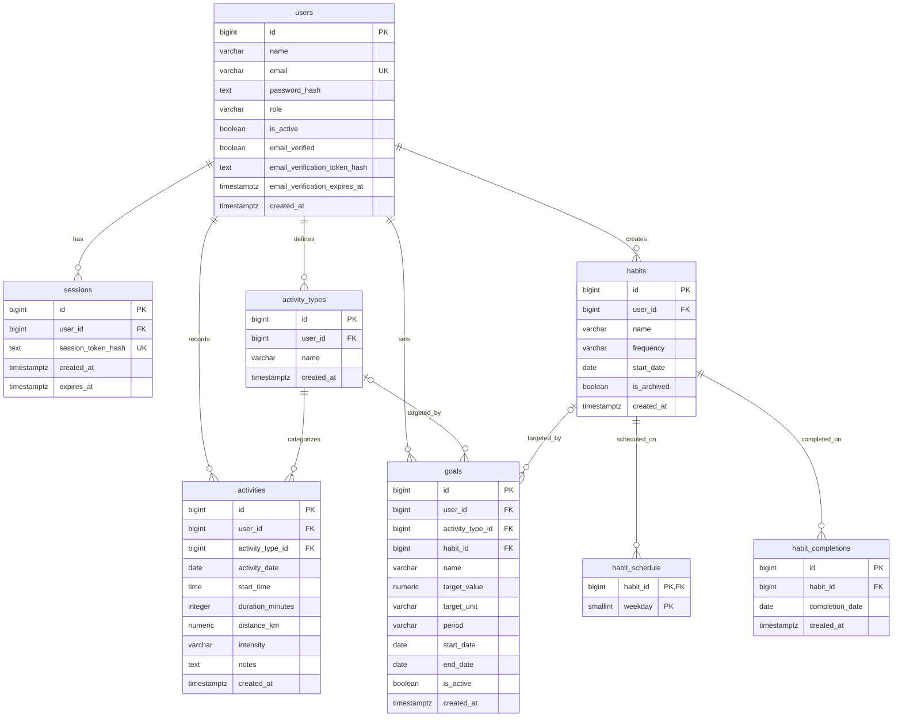

# 2. Modelul preliminar al bazei de date – WellTrack

## 2.1. Descriere generală

Baza de date a aplicației **WellTrack** va fi implementată folosind **PostgreSQL**.

Modelul preliminar conține 8 tabele:

- `users` – conturile utilizatorilor și verificarea emailului.
- `sessions` – sesiunile de autentificare.
- `activity_types` – tipurile de activități definite de utilizatori.
- `activities` – istoricul activităților efectuate.
- `habits` – obiceiurile definite de utilizatori.
- `habit_schedule` – zilele programate pentru obiceiuri.
- `habit_completions` – istoricul realizării obiceiurilor.
- `goals` – obiectivele personale.

**Observație:** Activities și Habits sunt independente. Un utilizator poate înregistra activități fără să bifeze obiceiuri și invers.

## 2.2. Structura tabelelor

### Tabelul `users`

Stochează informațiile necesare autentificării, verificării emailului și administrării conturilor.

| Câmp | Tip PostgreSQL | Descriere |
|---|---|---|
| `id` | BIGINT (PK) | Identificator unic |
| `name` | VARCHAR(100) | Numele utilizatorului |
| `email` | VARCHAR(255) | Adresa de email |
| `password_hash` | TEXT | Hash-ul parolei |
| `role` | VARCHAR(20) | `user` sau `admin` |
| `is_active` | BOOLEAN | Starea contului |
| `email_verified` | BOOLEAN | Indică dacă emailul a fost verificat |
| `email_verification_token_hash` | TEXT, NULL | Hash-ul tokenului de verificare |
| `email_verification_expires_at` | TIMESTAMPTZ, NULL | Momentul expirării tokenului |
| `created_at` | TIMESTAMPTZ | Momentul creării contului |

**Constrângeri:**
- `email` trebuie să fie unic, fără diferențiere între litere mari și mici.
- `role` acceptă valorile `user` și `admin`, având implicit `user`.
- `is_active` are implicit valoarea `TRUE`.
- `email_verified` are implicit valoarea `FALSE`.
- Un cont dezactivat nu poate accesa aplicația.
- Autentificarea este permisă numai după verificarea emailului.
- Câmpurile tokenului și expirării sunt fie ambele completate, fie ambele `NULL`.
- Un utilizator poate avea un singur token de verificare valid la un moment dat.

**Observații:**
- Parolele sunt stocate exclusiv sub formă de hash.
- Tokenul de verificare este generat aleatoriu și trimis utilizatorului prin email.
- În baza de date se stochează doar hash-ul tokenului.
- După verificarea emailului, `email_verified` devine `TRUE`, iar câmpurile aferente tokenului sunt resetate la `NULL`.
- La retrimiterea emailului, tokenul anterior este înlocuit și devine invalid.

### Tabelul `sessions`

Stochează sesiunile utilizatorilor autentificați.

| Câmp | Tip PostgreSQL | Descriere |
|---|---|---|
| `id` | BIGINT (PK) | Identificator unic |
| `user_id` | BIGINT (FK) | Utilizatorul autentificat |
| `session_token_hash` | TEXT | Hash-ul tokenului de sesiune |
| `created_at` | TIMESTAMPTZ | Momentul creării sesiunii |
| `expires_at` | TIMESTAMPTZ | Momentul expirării sesiunii |

**Constrângeri:**
- `user_id` referă `users(id)`.
- `session_token_hash` trebuie să fie unic.
- `expires_at` trebuie să fie ulterior lui `created_at`.
- Un utilizator poate avea mai multe sesiuni simultan.

**Observații:**
- Aplicația folosește autentificare session-based.
- Sesiunea este creată după autentificarea reușită.
- Browserul primește un cookie `HttpOnly` care conține tokenul sesiunii.
- În baza de date se păstrează doar hash-ul tokenului.
- La logout, sesiunea este invalidată.
- Sesiunile expirate sunt respinse și pot fi eliminate periodic.
- Backend-ul verifică starea contului și permisiunile utilizatorului la accesarea resurselor protejate.
- În producție, cookie-urile vor utiliza `Secure`, o politică `SameSite` adecvată și protecție CSRF.

### Tabelul `activity_types`

Conține tipurile de activități definite individual de fiecare utilizator.

| Câmp | Tip PostgreSQL | Descriere |
|---|---|---|
| `id` | BIGINT (PK) | Identificator unic |
| `user_id` | BIGINT (FK) | Utilizatorul care a definit activitatea |
| `name` | VARCHAR(100) | Denumirea activității |
| `created_at` | TIMESTAMPTZ | Momentul definirii activității |

**Constrângeri:**
- `user_id` referă `users(id)`.
- Combinația `(user_id, name)` trebuie să fie unică.
- Fiecare utilizator își poate defini propriile tipuri de activități.
- Tipurile de activități sunt independente de obiceiuri.

### Tabelul `activities`

Stochează fiecare înregistrare a unei activități efectuate de utilizator.

| Câmp | Tip PostgreSQL | Descriere |
|---|---|---|
| `id` | BIGINT (PK) | Identificator unic |
| `user_id` | BIGINT (FK) | Utilizatorul asociat |
| `activity_type_id` | BIGINT (FK) | Tipul activității |
| `activity_date` | DATE | Data efectuării activității |
| `start_time` | TIME, NULL | Ora începerii activității |
| `duration_minutes` | INTEGER, NULL | Durata activității |
| `distance_km` | NUMERIC(8,2), NULL | Distanța parcursă |
| `intensity` | VARCHAR(20), NULL | Intensitatea activității |
| `notes` | TEXT, NULL | Observații opționale |
| `created_at` | TIMESTAMPTZ | Momentul înregistrării |

**Constrângeri:**
- `user_id` referă `users(id)`.
- `activity_type_id` referă `activity_types(id)`.
- Tipul activității trebuie să aparțină utilizatorului.
- `duration_minutes` și `distance_km` trebuie să fie pozitive atunci când sunt completate.
- `intensity` acceptă valorile `light`, `moderate`, `hard` sau `NULL`.
- Același tip de activitate poate fi înregistrat de mai multe ori în aceeași zi.

**Observație:** `activity_date` reprezintă data realizării activității, în timp ce `created_at` reprezintă momentul introducerii în aplicație.

### Tabelul `habits`

Stochează obiceiurile repetitive definite de utilizatori.

| Câmp | Tip PostgreSQL | Descriere |
|---|---|---|
| `id` | BIGINT (PK) | Identificator unic |
| `user_id` | BIGINT (FK) | Proprietarul obiceiului |
| `name` | VARCHAR(150) | Denumirea obiceiului |
| `frequency` | VARCHAR(20) | `daily` sau `selected_days` |
| `start_date` | DATE | Data începerii obiceiului |
| `is_archived` | BOOLEAN | Indică dacă obiceiul este arhivat |
| `created_at` | TIMESTAMPTZ | Momentul creării |

**Constrângeri:**
- `user_id` referă `users(id)`.
- `frequency` acceptă valorile `daily` și `selected_days`.
- `is_archived` are implicit valoarea `FALSE`.
- Arhivarea unui obicei nu șterge istoricul realizărilor.
- Obiceiurile sunt independente de activități.

### Tabelul `habit_schedule`

Stochează zilele săptămânii în care este programat un obicei.

| Câmp | Tip PostgreSQL | Descriere |
|---|---|---|
| `habit_id` | BIGINT (PK, FK) | Obiceiul asociat |
| `weekday` | SMALLINT (PK) | Ziua săptămânii (1–7) |

**Constrângeri:**
- `habit_id` referă `habits(id)`.
- Cheia primară este `(habit_id, weekday)`.
- `weekday` acceptă valori între 1 (luni) și 7 (duminică).
- Pentru `selected_days` trebuie selectată cel puțin o zi.
- Pentru `daily`, toate zilele sunt considerate programate implicit.

### Tabelul `habit_completions`

Stochează zilele în care utilizatorul a bifat realizarea unui obicei.

| Câmp | Tip PostgreSQL | Descriere |
|---|---|---|
| `id` | BIGINT (PK) | Identificator unic |
| `habit_id` | BIGINT (FK) | Obiceiul realizat |
| `completion_date` | DATE | Data realizării |
| `created_at` | TIMESTAMPTZ | Momentul bifării |

**Constrângeri:**
- `habit_id` referă `habits(id)`.
- Combinația `(habit_id, completion_date)` trebuie să fie unică.
- Un obicei poate fi bifat o singură dată pentru aceeași zi.

**Observație:** Bifarea confirmă realizarea obiceiului, fără stocarea unei cantități numerice.

### Tabelul `goals`

Stochează obiectivele personale ale utilizatorilor.

| Câmp | Tip PostgreSQL | Descriere |
|---|---|---|
| `id` | BIGINT (PK) | Identificator unic |
| `user_id` | BIGINT (FK) | Proprietarul obiectivului |
| `activity_type_id` | BIGINT (FK), NULL | Tipul activității urmărite |
| `habit_id` | BIGINT (FK), NULL | Obiceiul urmărit |
| `name` | VARCHAR(150) | Denumirea obiectivului |
| `target_value` | NUMERIC(10,2) | Valoarea țintă |
| `target_unit` | VARCHAR(20) | `sessions`, `minutes`, `km`, `days` |
| `period` | VARCHAR(20) | `daily`, `weekly`, `monthly`, `custom` |
| `start_date` | DATE | Data începerii obiectivului |
| `end_date` | DATE, NULL | Data încheierii |
| `is_active` | BOOLEAN | Starea obiectivului |
| `created_at` | TIMESTAMPTZ | Momentul creării |

**Constrângeri:**
- `user_id` referă `users(id)`.
- `activity_type_id` referă `activity_types(id)`, dacă este completat.
- `habit_id` referă `habits(id)`, dacă este completat.
- `target_value` trebuie să fie pozitiv.
- `end_date` trebuie să fie mai mare sau egală cu `start_date`.
- `activity_type_id` și `habit_id` nu pot fi completate simultan.
- Activitatea sau obiceiul asociat trebuie să aparțină utilizatorului.

**Interpretarea obiectivelor:**
- `activity_type_id` completat: obiectiv pentru o anumită activitate.
- `habit_id` completat: obiectiv pentru un anumit obicei.
- Ambele câmpuri `NULL`: obiectiv pentru toate activitățile.

**Unități permise:**
- Activități: `sessions`, `minutes`, `km`.
- Obiceiuri: `days`.

**Observație:** Progresul obiectivelor nu este stocat separat, ci calculat din `activities` sau `habit_completions`.

## 2.3. Relațiile dintre tabele

| Relație | Cardinalitate | Descriere |
|---|---|---|
| `users` → `sessions` | 1:N | Un utilizator poate avea mai multe sesiuni |
| `users` → `activity_types` | 1:N | Un utilizator poate defini mai multe tipuri de activități |
| `users` → `activities` | 1:N | Un utilizator poate înregistra mai multe activități |
| `activity_types` → `activities` | 1:N | Un tip poate avea mai multe înregistrări |
| `users` → `habits` | 1:N | Un utilizator poate defini mai multe obiceiuri |
| `habits` → `habit_schedule` | 1:N | Un obicei poate avea mai multe zile programate |
| `habits` → `habit_completions` | 1:N | Un obicei poate avea mai multe realizări |
| `users` → `goals` | 1:N | Un utilizator poate avea mai multe obiective |
| `activity_types` → `goals` | 1:N (opțional) | Un tip poate fi urmărit de mai multe obiective |
| `habits` → `goals` | 1:N (opțional) | Un obicei poate fi urmărit de mai multe obiective |

## 2.4. Diagrama ERD

## 2.5. Autentificarea și verificarea emailului

Aplicația va utiliza autentificare bazată pe sesiuni, cu stocarea acestora în PostgreSQL.

### Înregistrarea utilizatorului

1. Utilizatorul completează formularul de înregistrare.
2. FastAPI validează datele și creează contul în `users`, cu `email_verified = FALSE`.
3. Sistemul generează un token de verificare.
4. Hash-ul tokenului și data expirării sunt salvate în `users`.
5. Utilizatorul primește un email cu linkul de verificare.
6. La accesarea linkului, FastAPI validează tokenul și expirarea.
7. Dacă verificarea reușește, `email_verified` devine `TRUE`, iar câmpurile aferente tokenului sunt resetate la `NULL`.

Dacă utilizatorul solicită un nou email, sistemul generează un token nou și îl înlocuiește pe cel anterior.

### Autentificarea utilizatorului

1. Utilizatorul introduce emailul și parola.
2. FastAPI verifică datele de autentificare.
3. Sistemul verifică `is_active` și `email_verified`.
4. Dacă verificările reușesc, se creează o înregistrare în `sessions`.
5. Browserul primește un cookie `HttpOnly` cu tokenul de sesiune.
6. La cererile ulterioare, FastAPI validează sesiunea și drepturile utilizatorului.

### Deconectarea utilizatorului

1. Utilizatorul selectează opțiunea Logout.
2. FastAPI invalidează sesiunea curentă.
3. Cookie-ul sesiunii este eliminat din browser.
4. Utilizatorul nu mai poate accesa endpoint-urile protejate folosind sesiunea respectivă.

## 2.6. Calcularea statisticilor

Statisticile vor fi calculate folosind datele existente, fără tabele suplimentare.

| Funcționalitate | Sursa datelor |
|---|---|
| Activități recente | `activities` + `activity_types` |
| Minute active | Suma `duration_minutes` |
| Distanță totală | Suma `distance_km` |
| Statistici săptămânale/lunare | Agregări din `activities` |
| Obiceiuri programate | `habits` + `habit_schedule` |
| Progresul obiceiurilor | `habit_completions` |
| Progresul obiectivelor | `goals` + `activities` sau `habit_completions` |
| Calendarul activităților | Activități grupate după dată |

## 2.7. Aspecte de clarificat

Înainte de implementarea efectivă în PostgreSQL, trebuie stabilite următoarele:

1. **Obiective recurente:** modul de calcul pentru obiective zilnice, săptămânale, lunare și cu perioadă personalizată.
2. **Monitorizarea pașilor:** modelul actual nu permite stocarea numerică a pașilor.
3. **Ștergerea datelor:** reguli pentru ștergerea activităților, obiceiurilor, obiectivelor și sesiunilor.
4. **Integritatea datelor:** verificarea apartenenței activităților, obiceiurilor și obiectivelor la utilizator.
5. **Verificarea emailului:** alegerea serviciului SMTP/API, durata de valabilitate a tokenurilor și limitarea retrimiterilor.
6. **Gestionarea sesiunilor:** durata sesiunilor, expirarea și invalidarea acestora la dezactivarea conturilor.
7. **Modificarea emailului:** stabilirea procesului de reverificare atunci când utilizatorul își schimbă adresa.
8. **Validarea obiectivelor:** definirea combinațiilor permise între tipurile de obiective, unitățile de măsură și perioade.

**Notă:** Acesta este modelul preliminar al bazei de date, versiunea 3. Constrângerile de apartenență pot fi implementate prin chei externe compuse și verificări suplimentare în backend.
