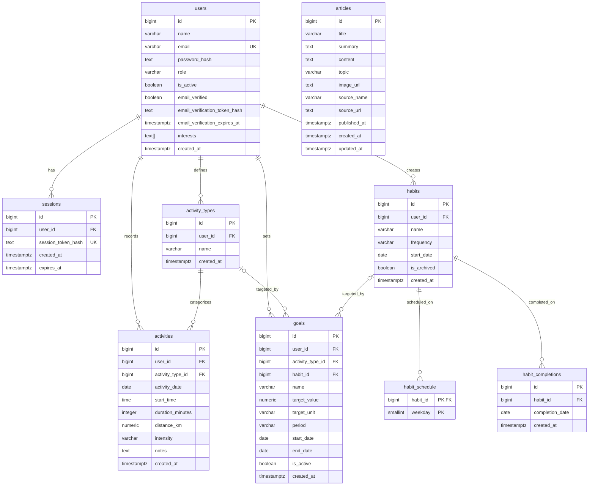

# 2. Modelul preliminar al bazei de date – WellTrack

## 2.1. Descriere generala

Baza de date a aplicatiei **WellTrack** va fi implementata folosind **PostgreSQL**.

Modelul preliminar contine 9 tabele:

- `users` – conturile utilizatorilor, verificarea emailului si interesele pentru recomandarea articolelor.
- `sessions` – sesiunile de autentificare.
- `activity_types` – tipurile de activitati definite de utilizatori.
- `activities` – istoricul activitatilor efectuate.
- `habits` – obiceiurile definite de utilizatori.
- `habit_schedule` – zilele programate pentru obiceiuri.
- `habit_completions` – istoricul realizarii obiceiurilor.
- `goals` – obiectivele personale.
- `articles` – catalogul comun de articole educationale.

**Observatie:** Activities si Habits sunt independente. Un utilizator poate inregistra activitati fara sa bifeze obiceiuri si invers.

## 2.2. Structura tabelelor

### Tabelul `users`

Stocheaza informatiile necesare autentificarii, verificarii emailului, administrarii conturilor si recomandarii articolelor dupa interesele selectate.

| Camp | Tip PostgreSQL | Descriere |
|---|---|---|
| `id` | BIGINT (PK) | Identificator unic |
| `name` | VARCHAR(100) | Numele utilizatorului |
| `email` | VARCHAR(255) | Adresa de email |
| `password_hash` | TEXT | Hash-ul parolei |
| `role` | VARCHAR(20) | `user` sau `admin` |
| `is_active` | BOOLEAN | Starea contului |
| `email_verified` | BOOLEAN | Indica daca emailul a fost verificat |
| `email_verification_token_hash` | TEXT, NULL | Hash-ul tokenului de verificare |
| `email_verification_expires_at` | TIMESTAMPTZ, NULL | Momentul expirarii tokenului |
| `interests` | TEXT[] | Lista temelor de interes selectate, de exemplu `running`, `habits` sau `recovery` |
| `created_at` | TIMESTAMPTZ | Momentul crearii contului |

**Constrangeri:**
- `email` trebuie sa fie unic, fara diferentiere intre litere mari si mici.
- `role` accepta valorile `user` si `admin`, avand implicit `user`.
- `is_active` are implicit valoarea `TRUE`.
- `email_verified` are implicit valoarea `FALSE`.
- Un cont dezactivat nu poate accesa aplicatia.
- Autentificarea este permisa numai dupa verificarea emailului.
- Campurile tokenului si expirarii sunt fie ambele completate, fie ambele `NULL`.
- Un utilizator poate avea un singur token de verificare valid la un moment dat.
- `interests` este obligatoriu si are implicit valoarea unui tablou gol (`{}`).
- Interesele nu pot contine valori `NULL`, goale sau duplicate. Backend-ul valideaza valorile folosind acelasi vocabular de teme ca pentru `articles.topic`.

**Observatii:**
- Parolele sunt stocate exclusiv sub forma de hash.
- Tokenul de verificare este generat aleatoriu si trimis utilizatorului prin email.
- In baza de date se stocheaza doar hash-ul tokenului.
- Dupa verificarea emailului, `email_verified` devine `TRUE`, iar campurile aferente tokenului sunt resetate la `NULL`.
- La retrimiterea emailului, tokenul anterior este inlocuit si devine invalid.

### Tabelul `sessions`

Stocheaza sesiunile utilizatorilor autentificati.

| Camp | Tip PostgreSQL | Descriere |
|---|---|---|
| `id` | BIGINT (PK) | Identificator unic |
| `user_id` | BIGINT (FK) | Utilizatorul autentificat |
| `session_token_hash` | TEXT | Hash-ul tokenului de sesiune |
| `created_at` | TIMESTAMPTZ | Momentul crearii sesiunii |
| `expires_at` | TIMESTAMPTZ | Momentul expirarii sesiunii |

**Constrangeri:**
- `user_id` refera `users(id)`.
- `session_token_hash` trebuie sa fie unic.
- `expires_at` trebuie sa fie ulterior lui `created_at`.
- Un utilizator poate avea mai multe sesiuni simultan.

**Observatii:**
- Aplicatia foloseste autentificare session-based.
- Sesiunea este creata dupa autentificarea reusita.
- Browserul primeste un cookie `HttpOnly` care contine tokenul sesiunii.
- In baza de date se pastreaza doar hash-ul tokenului.
- La logout, sesiunea este invalidata.
- Sesiunile expirate sunt respinse si pot fi eliminate periodic.
- Durata implicita a unei sesiuni este de 7 zile, configurabila prin `SESSION_TTL_DAYS`.
- Backend-ul verifica starea contului si permisiunile utilizatorului la accesarea resurselor protejate.
- In productie, cookie-urile vor utiliza `Secure`, o politica `SameSite` adecvata si protectie CSRF.
- Implementarea foloseste cookie-ul `welltrack_session`, cu `HttpOnly` si `SameSite=Lax`. Cererile care modifica starea necesita headerul `X-Requested-With: WellTrack` si o origine permisa, atunci cand browserul transmite `Origin`.

### Tabelul `activity_types`

Contine tipurile de activitati definite individual de fiecare utilizator.

| Camp | Tip PostgreSQL | Descriere |
|---|---|---|
| `id` | BIGINT (PK) | Identificator unic |
| `user_id` | BIGINT (FK) | Utilizatorul care a definit activitatea |
| `name` | VARCHAR(100) | Denumirea activitatii |
| `created_at` | TIMESTAMPTZ | Momentul definirii activitatii |

**Constrangeri:**
- `user_id` refera `users(id)`.
- Combinatia `(user_id, name)` trebuie sa fie unica.
- Fiecare utilizator isi poate defini propriile tipuri de activitati.
- Tipurile de activitati sunt independente de obiceiuri.

### Tabelul `activities`

Stocheaza fiecare inregistrare a unei activitati efectuate de utilizator.

| Camp | Tip PostgreSQL | Descriere |
|---|---|---|
| `id` | BIGINT (PK) | Identificator unic |
| `user_id` | BIGINT (FK) | Utilizatorul asociat |
| `activity_type_id` | BIGINT (FK) | Tipul activitatii |
| `activity_date` | DATE | Data efectuarii activitatii |
| `start_time` | TIME, NULL | Ora inceperii activitatii |
| `duration_minutes` | INTEGER, NULL | Durata activitatii |
| `distance_km` | NUMERIC(8,2), NULL | Distanta parcursa |
| `intensity` | VARCHAR(20), NULL | Intensitatea activitatii |
| `notes` | TEXT, NULL | Observatii optionale |
| `created_at` | TIMESTAMPTZ | Momentul inregistrarii |

**Constrangeri:**
- `user_id` refera `users(id)`.
- `activity_type_id` refera `activity_types(id)`.
- Tipul activitatii trebuie sa apartina utilizatorului.
- `duration_minutes` si `distance_km` trebuie sa fie pozitive atunci cand sunt completate.
- `intensity` accepta valorile `light`, `moderate`, `hard` sau `NULL`.
- Acelasi tip de activitate poate fi inregistrat de mai multe ori in aceeasi zi.

**Observatie:** `activity_date` reprezinta data realizarii activitatii, in timp ce `created_at` reprezinta momentul introducerii in aplicatie.

### Tabelul `habits`

Stocheaza obiceiurile repetitive definite de utilizatori.

| Camp | Tip PostgreSQL | Descriere |
|---|---|---|
| `id` | BIGINT (PK) | Identificator unic |
| `user_id` | BIGINT (FK) | Proprietarul obiceiului |
| `name` | VARCHAR(150) | Denumirea obiceiului |
| `frequency` | VARCHAR(20) | `daily` sau `selected_days` |
| `start_date` | DATE | Data inceperii obiceiului |
| `is_archived` | BOOLEAN | Indica daca obiceiul este arhivat |
| `created_at` | TIMESTAMPTZ | Momentul crearii |

**Constrangeri:**
- `user_id` refera `users(id)`.
- `frequency` accepta valorile `daily` si `selected_days`.
- `is_archived` are implicit valoarea `FALSE`.
- Arhivarea unui obicei nu sterge istoricul realizarilor.
- Obiceiurile sunt independente de activitati.

### Tabelul `habit_schedule`

Stocheaza zilele saptamanii in care este programat un obicei.

| Camp | Tip PostgreSQL | Descriere |
|---|---|---|
| `habit_id` | BIGINT (PK, FK) | Obiceiul asociat |
| `weekday` | SMALLINT (PK) | Ziua saptamanii (1–7) |

**Constrangeri:**
- `habit_id` refera `habits(id)`.
- Cheia primara este `(habit_id, weekday)`.
- `weekday` accepta valori intre 1 (luni) si 7 (duminica).
- Pentru `selected_days` trebuie selectata cel putin o zi.
- Pentru `daily`, toate zilele sunt considerate programate implicit.

### Tabelul `habit_completions`

Stocheaza zilele in care utilizatorul a bifat realizarea unui obicei.

| Camp | Tip PostgreSQL | Descriere |
|---|---|---|
| `id` | BIGINT (PK) | Identificator unic |
| `habit_id` | BIGINT (FK) | Obiceiul realizat |
| `completion_date` | DATE | Data realizarii |
| `created_at` | TIMESTAMPTZ | Momentul bifarii |

**Constrangeri:**
- `habit_id` refera `habits(id)`.
- Combinatia `(habit_id, completion_date)` trebuie sa fie unica.
- Un obicei poate fi bifat o singura data pentru aceeasi zi.

**Observatie:** Bifarea confirma realizarea obiceiului, fara stocarea unei cantitati numerice.

### Tabelul `goals`

Stocheaza obiectivele personale ale utilizatorilor.

| Camp | Tip PostgreSQL | Descriere |
|---|---|---|
| `id` | BIGINT (PK) | Identificator unic |
| `user_id` | BIGINT (FK) | Proprietarul obiectivului |
| `activity_type_id` | BIGINT (FK), NULL | Tipul activitatii urmarite |
| `habit_id` | BIGINT (FK), NULL | Obiceiul urmarit |
| `name` | VARCHAR(150) | Denumirea obiectivului |
| `target_value` | NUMERIC(10,2) | Valoarea tinta |
| `target_unit` | VARCHAR(20) | `sessions`, `minutes`, `km`, `days` |
| `period` | VARCHAR(20) | `daily`, `weekly`, `monthly`, `custom` |
| `start_date` | DATE | Data inceperii obiectivului |
| `end_date` | DATE, NULL | Data incheierii |
| `is_active` | BOOLEAN | Starea obiectivului |
| `created_at` | TIMESTAMPTZ | Momentul crearii |

**Constrangeri:**
- `user_id` refera `users(id)`.
- `activity_type_id` refera `activity_types(id)`, daca este completat.
- `habit_id` refera `habits(id)`, daca este completat.
- `target_value` trebuie sa fie pozitiv.
- `end_date` trebuie sa fie mai mare sau egala cu `start_date`.
- `activity_type_id` si `habit_id` nu pot fi completate simultan.
- Activitatea sau obiceiul asociat trebuie sa apartina utilizatorului.

**Interpretarea obiectivelor:**
- `activity_type_id` completat: obiectiv pentru o anumita activitate.
- `habit_id` completat: obiectiv pentru un anumit obicei.
- Ambele campuri `NULL`: obiectiv pentru toate activitatile.

**Unitati permise:**
- Activitati: `sessions`, `minutes`, `km`.
- Obiceiuri: `days`.

**Observatie:** Progresul obiectivelor nu este stocat separat, ci calculat din `activities` sau `habit_completions`.

### Tabelul `articles`

Stocheaza articolele educationale disponibile in sectiunea Learn. Catalogul este comun tuturor utilizatorilor; fiecare articol este stocat o singura data.

| Camp | Tip PostgreSQL | Descriere |
|---|---|---|
| `id` | BIGINT (PK) | Identificator unic |
| `title` | VARCHAR(255) | Titlul articolului |
| `summary` | TEXT | Rezumatul afisat in lista articolelor |
| `content` | TEXT, NULL | Continutul articolului in format Markdown, atunci cand este disponibil pentru afisare in aplicatie |
| `topic` | VARCHAR(50) | Tema principala, de exemplu `running`, `habits` sau `recovery` |
| `image_url` | TEXT, NULL | Adresa imaginii de prezentare |
| `source_name` | VARCHAR(150), NULL | Denumirea sursei pentru un articol extern |
| `source_url` | TEXT, NULL | Linkul catre articolul original, daca exista |
| `published_at` | TIMESTAMPTZ | Momentul publicarii articolului |
| `created_at` | TIMESTAMPTZ | Momentul adaugarii in catalog |
| `updated_at` | TIMESTAMPTZ | Momentul ultimei actualizari a inregistrarii |

**Constrangeri:**

- `title`, `summary` si `topic` sunt obligatorii si nu pot fi siruri goale sau formate doar din spatii.
- Articolul trebuie sa aiba fie un `content` nevid, fie un `source_url` nevid, fie ambele.
- `updated_at` trebuie sa fie mai mare sau egal cu `created_at`.
- Fiecare articol are o singura tema principala, pastrata direct in campul `topic`.

**Observatii:**

- Articolele pot fi proprii sau preluate din surse care permit utilizarea continutului. Alegerea si integrarea unui API extern vor fi stabilite ulterior.
- Daca este disponibil doar rezumatul si linkul original, utilizatorul va putea deschide articolul la sursa. Lectura integrala in aplicatie necesita completarea campului `content`.
- Cuprinsul si timpul estimat de lectura pot fi calculate din continut, fara campuri suplimentare.
- Recomandarea articolelor se bazeaza pe potrivirea dintre `topic` si lista `users.interests`.

### Recomandarea articolelor dupa interese

Interesele sunt selectate explicit de utilizator si pot fi actualizate ulterior. Pentru aceasta versiune, lista este pastrata direct in `users.interests`, fara un tabel suplimentar.

**Comportament propus:**

1. Backend-ul identifica utilizatorul din sesiune si citeste interesele selectate.
2. Selecteaza articolele a caror tema principala apare in `users.interests` si le ordoneaza dupa `published_at` descrescator, apoi dupa `id` descrescator.
3. Daca utilizatorul nu a selectat interese sau nu exista articole potrivite, afiseaza cele mai recente articole din catalog ca selectie generala.
4. Modificarea intereselor este reflectata la urmatoarea solicitare a recomandarilor.

De exemplu, pentru interesele `running` si `recovery`, sunt recomandate articolele cu una dintre aceste teme. Recomandarile sunt calculate la cerere; nu se stocheaza o relatie individuala intre utilizator si articol.

## 2.3. Relatiile dintre tabele

| Relatie | Cardinalitate | Descriere |
|---|---|---|
| `users` → `sessions` | 1:N | Un utilizator poate avea mai multe sesiuni |
| `users` → `activity_types` | 1:N | Un utilizator poate defini mai multe tipuri de activitati |
| `users` → `activities` | 1:N | Un utilizator poate inregistra mai multe activitati |
| `activity_types` → `activities` | 1:N | Un tip poate avea mai multe inregistrari |
| `users` → `habits` | 1:N | Un utilizator poate defini mai multe obiceiuri |
| `habits` → `habit_schedule` | 1:N | Un obicei poate avea mai multe zile programate |
| `habits` → `habit_completions` | 1:N | Un obicei poate avea mai multe realizari |
| `users` → `goals` | 1:N | Un utilizator poate avea mai multe obiective |
| `activity_types` → `goals` | 1:N (optional) | Un tip poate fi urmarit de mai multe obiective |
| `habits` → `goals` | 1:N (optional) | Un obicei poate fi urmarit de mai multe obiective |

Tabelul `articles` reprezinta un catalog comun si nu are o cheie externa catre `users`. Potrivirea temelor cu interesele utilizatorului este realizata de backend la calcularea recomandarilor.

## 2.4. Diagrama ERD

## 2.5. Autentificarea si verificarea emailului

Aplicatia va utiliza autentificare bazata pe sesiuni, cu stocarea acestora in PostgreSQL.

### Inregistrarea utilizatorului

1. Utilizatorul completeaza formularul de inregistrare.
2. FastAPI valideaza datele si creeaza contul in `users`, cu `email_verified = FALSE`.
3. Sistemul genereaza un token de verificare.
4. Hash-ul tokenului si data expirarii sunt salvate in `users`.
5. Utilizatorul primeste un email cu linkul de verificare.
6. La accesarea linkului, FastAPI valideaza tokenul si expirarea.
7. Daca verificarea reuseste, `email_verified` devine `TRUE`, iar campurile aferente tokenului sunt resetate la `NULL`.

Daca utilizatorul solicita un nou email, sistemul genereaza un token nou si il inlocuieste pe cel anterior.

Tokenul de verificare expira implicit dupa 60 de minute, iar retrimiterea este permisa dupa minimum 60 de secunde. In dezvoltare, mesajele sunt salvate local in `backend/.local/emails/`; trimiterea reala prin Resend se activeaza prin configuratia din `.env`. Tokenurile nu sunt returnate prin API.

### Autentificarea utilizatorului

1. Utilizatorul introduce emailul si parola.
2. FastAPI verifica datele de autentificare.
3. Sistemul verifica `is_active` si `email_verified`.
4. Daca verificarile reusesc, se creeaza o inregistrare in `sessions`.
5. Browserul primeste un cookie `HttpOnly` cu tokenul de sesiune.
6. La cererile ulterioare, FastAPI valideaza sesiunea si drepturile utilizatorului.

### Deconectarea utilizatorului

1. Utilizatorul selecteaza optiunea Logout.
2. FastAPI invalideaza sesiunea curenta.
3. Cookie-ul sesiunii este eliminat din browser.
4. Utilizatorul nu mai poate accesa endpoint-urile protejate folosind sesiunea respectiva.

## 2.6. Calcularea statisticilor

Statisticile vor fi calculate folosind datele existente, fara tabele suplimentare.

| Functionalitate | Sursa datelor |
|---|---|
| Activitati recente | `activities` + `activity_types` |
| Minute active | Suma `duration_minutes` |
| Distanta totala | Suma `distance_km` |
| Statistici saptamanale/lunare | Agregari din `activities` |
| Obiceiuri programate | `habits` + `habit_schedule` |
| Progresul obiceiurilor | `habit_completions` |
| Progresul obiectivelor | `goals` + `activities` sau `habit_completions` |
| Calendarul activitatilor | Activitati grupate dupa data |

## 2.7. Principalele endpoint-uri propuse

Backend-ul FastAPI va expune un API REST cu prefixul `/api`. Rutele din tabelele de mai jos sunt relative la acest prefix. Datele vor fi transmise in format JSON, cu exceptia fisierelor CSV.

**Reguli de acces:**

- **Public:** nu necesita autentificare.
- **Utilizator autentificat:** necesita o sesiune valida si un cont activ, cu emailul verificat. Accesul este limitat la datele proprii.
- **Administrator:** necesita o sesiune valida si rolul `admin`, pe langa conditiile unui cont activ si verificat.
- Pentru resursele personale, backend-ul determina utilizatorul din sesiune si verifica apartenenta resurselor indicate prin ID. Rolul de administrator nu acorda implicit acces la activitatile, obiceiurile sau obiectivele altor utilizatori.

### 2.7.1. Autentificare si cont

| Metoda | Endpoint | Descriere | Acces |
|---|---|---|---|
| `POST` | `/auth/register` | Creeaza un cont cu rolul `user` si initiaza trimiterea emailului de verificare. | Public |
| `POST` | `/auth/verify-email` | Primeste tokenul din linkul de verificare, valideaza hash-ul si expirarea acestuia si marcheaza emailul ca verificat. | Public |
| `POST` | `/auth/resend-verification` | Primeste adresa de email si solicita trimiterea unui token nou de verificare, invalidandu-l pe cel anterior. | Public |
| `POST` | `/auth/login` | Verifica emailul, parola si starea contului, creeaza sesiunea si seteaza cookie-ul `HttpOnly`. | Public |
| `POST` | `/auth/logout` | Invalideaza sesiunea curenta si elimina cookie-ul de autentificare. | Utilizator autentificat |
| `GET` | `/auth/me` | Returneaza datele contului autentificat, inclusiv rolul, fara parola hash-uita sau tokenuri. | Utilizator autentificat |

### 2.7.2. Tipuri de activitati si activitati efectuate

| Metoda | Endpoint | Descriere | Acces |
|---|---|---|---|
| `GET` | `/activity-types` | Listeaza tipurile de activitati definite de utilizator. | Utilizator autentificat |
| `POST` | `/activity-types` | Creeaza un tip de activitate, cu denumire unica pentru utilizatorul curent. | Utilizator autentificat |
| `PATCH` | `/activity-types/{id}` | Modifica denumirea unui tip de activitate propriu. | Utilizator autentificat |
| `DELETE` | `/activity-types/{id}` | Solicita stergerea unui tip de activitate, conform regulilor privind inregistrarile si obiectivele asociate. | Utilizator autentificat |
| `GET` | `/activities` | Listeaza activitatile proprii, cu paginare si filtre optionale dupa intervalul de date si tipul activitatii. | Utilizator autentificat |
| `POST` | `/activities` | Inregistreaza o activitate, validand tipul asociat, data, durata, distanta si intensitatea. | Utilizator autentificat |
| `GET` | `/activities/{id}` | Returneaza detaliile unei activitati proprii. | Utilizator autentificat |
| `PATCH` | `/activities/{id}` | Modifica datele unei activitati proprii. | Utilizator autentificat |
| `DELETE` | `/activities/{id}` | Sterge o activitate proprie; progresul si statisticile vor reflecta datele ramase. | Utilizator autentificat |

### 2.7.3. Obiceiuri si realizarea acestora

| Metoda | Endpoint | Descriere | Acces |
|---|---|---|---|
| `GET` | `/habits` | Listeaza obiceiurile proprii si programarea lor, cu posibilitatea filtrarii dupa starea de arhivare. | Utilizator autentificat |
| `POST` | `/habits` | Creeaza un obicei si programarea acestuia; pentru `selected_days` primeste cel putin o zi a saptamanii. | Utilizator autentificat |
| `GET` | `/habits/{id}` | Returneaza detaliile unui obicei propriu si zilele programate. | Utilizator autentificat |
| `PATCH` | `/habits/{id}` | Actualizeaza un obicei propriu, inclusiv starea `is_archived`; arhivarea pastreaza istoricul realizarilor. | Utilizator autentificat |
| `GET` | `/habits/{id}/completions` | Listeaza realizarile unui obicei propriu pentru un interval de date. | Utilizator autentificat |
| `PUT` | `/habits/{id}/completions/{date}` | Marcheaza obiceiul ca realizat in ziua indicata. Repetarea cererii nu creeaza inregistrari duplicate. | Utilizator autentificat |
| `DELETE` | `/habits/{id}/completions/{date}` | Elimina bifarea realizarii obiceiului pentru ziua indicata. | Utilizator autentificat |

Parametrul `{date}` va utiliza formatul `YYYY-MM-DD`. Crearea obiceiului si salvarea zilelor programate se vor realiza in aceeasi tranzactie.

### 2.7.4. Obiective si progres

| Metoda | Endpoint | Descriere | Acces |
|---|---|---|---|
| `GET` | `/goals` | Listeaza obiectivele proprii, cu posibilitatea filtrarii dupa starea activa. | Utilizator autentificat |
| `POST` | `/goals` | Creeaza un obiectiv, validand tinta, unitatea, perioada si apartenenta activitatii sau obiceiului asociat. | Utilizator autentificat |
| `GET` | `/goals/{id}` | Returneaza configuratia unui obiectiv propriu. | Utilizator autentificat |
| `PATCH` | `/goals/{id}` | Modifica un obiectiv propriu sau il dezactiveaza prin `is_active`. | Utilizator autentificat |
| `DELETE` | `/goals/{id}` | Sterge un obiectiv propriu, fara a sterge activitatile sau realizarile obiceiului urmarit. | Utilizator autentificat |
| `GET` | `/goals/{id}/progress` | Returneaza intervalul evaluat, valoarea realizata, valoarea tinta si procentul de progres, calculate din activitati sau realizarile obiceiului. | Utilizator autentificat |

### 2.7.5. Dashboard si statistici

| Metoda | Endpoint | Descriere | Acces |
|---|---|---|---|
| `GET` | `/dashboard` | Returneaza un rezumat cu activitatile recente, obiceiurile programate pentru ziua curenta si progresul obiectivelor active. | Utilizator autentificat |
| `GET` | `/statistics` | Returneaza numarul de activitati, minutele active, distanta totala si numarul de realizari ale obiceiurilor, cu agregari pentru grafice. | Utilizator autentificat |

Pentru statistici, parametrii propusi sunt `start_date`, `end_date`, `group_by` (`day`, `week`, `month`) si, optional, `activity_type_id` pentru filtrarea indicatorilor de activitate.

### 2.7.6. Import si export CSV

| Metoda | Endpoint | Descriere | Acces |
|---|---|---|---|
| `POST` | `/activities/import` | Primeste un fisier CSV prin `multipart/form-data`, valideaza randurile si importa activitati in contul curent. Returneaza un rezultat al importului si eventualele erori de validare. | Utilizator autentificat |
| `GET` | `/activities/export` | Returneaza un fisier `text/csv` cu activitatile proprii, filtrate optional dupa intervalul de date si tipul activitatii. | Utilizator autentificat |

Structura fisierului CSV si regulile pentru importuri partiale sau duplicate vor fi stabilite inaintea implementarii.

### 2.7.7. Administrarea conturilor

| Metoda | Endpoint | Descriere | Acces |
|---|---|---|---|
| `GET` | `/admin/users` | Listeaza conturile cu paginare si filtre dupa starea activa sau verificarea emailului, fara hash-uri de parole ori tokenuri. | Administrator |
| `PATCH` | `/admin/users/{id}` | Activeaza sau dezactiveaza un cont prin modificarea campului `is_active`. Un cont dezactivat nu mai poate accesa resursele protejate. | Administrator |

### 2.7.8. Articole si interese

| Metoda | Endpoint | Descriere | Acces |
|---|---|---|---|
| `PATCH` | `/auth/me/interests` | Inlocuieste lista de interese a utilizatorului curent cu temele validate din cerere. O lista goala elimina preferintele selectate. | Utilizator autentificat |
| `GET` | `/articles` | Listeaza catalogul de articole cu paginare si un filtru optional dupa `topic`. | Utilizator autentificat |
| `GET` | `/articles/recommended` | Returneaza cu paginare articolele potrivite intereselor utilizatorului sau selectia generala, indicand daca rezultatele sunt personalizate. | Utilizator autentificat |
| `GET` | `/articles/{id}` | Returneaza detaliile unui articol din catalogul comun, inclusiv continutul disponibil si linkul sursei. | Utilizator autentificat |

Catalogul de articole este comun utilizatorilor autentificati; restrictia privind accesul exclusiv la datele proprii se aplica listei personale de interese.

Endpoint-urile reprezinta o propunere preliminara. Regulile inca deschise privind stergerile, perioadele obiectivelor si modificarea obiceiurilor vor fi clarificate inaintea implementarii.

## 2.8. Aspecte de clarificat

Inainte de implementarea efectiva in PostgreSQL, trebuie stabilite urmatoarele:

1. **Obiective recurente:** modul de calcul pentru obiective zilnice, saptamanale, lunare si cu perioada personalizata.
2. **Monitorizarea pasilor:** modelul actual nu permite stocarea numerica a pasilor.
3. **Stergerea datelor:** reguli pentru stergerea activitatilor, obiceiurilor, obiectivelor si sesiunilor.
4. **Integritatea datelor:** verificarea apartenentei activitatilor, obiceiurilor si obiectivelor la utilizator.
5. **Verificarea emailului:** alegerea serviciului SMTP/API, durata de valabilitate a tokenurilor si limitarea retrimiterilor.
6. **Gestionarea sesiunilor:** durata sesiunilor, expirarea si invalidarea acestora la dezactivarea conturilor.
7. **Modificarea emailului:** stabilirea procesului de reverificare atunci cand utilizatorul isi schimba adresa.
8. **Validarea obiectivelor:** definirea combinatiilor permise intre tipurile de obiective, unitatile de masura si perioade.

**Nota:** Acesta este modelul preliminar al bazei de date, versiunea 4. Constrangerile de apartenenta pot fi implementate prin chei externe compuse si verificari suplimentare in backend.
