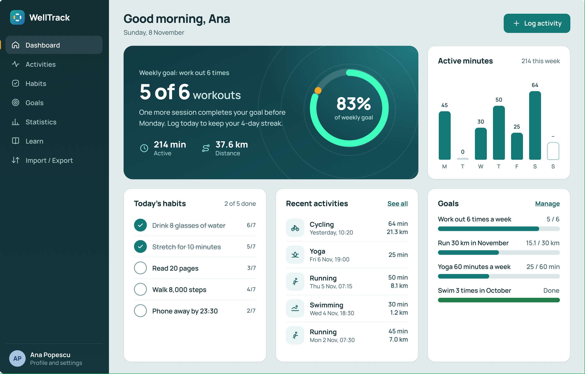
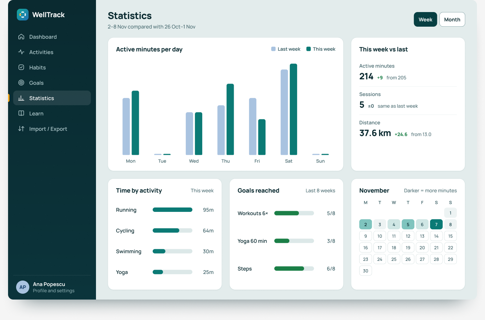
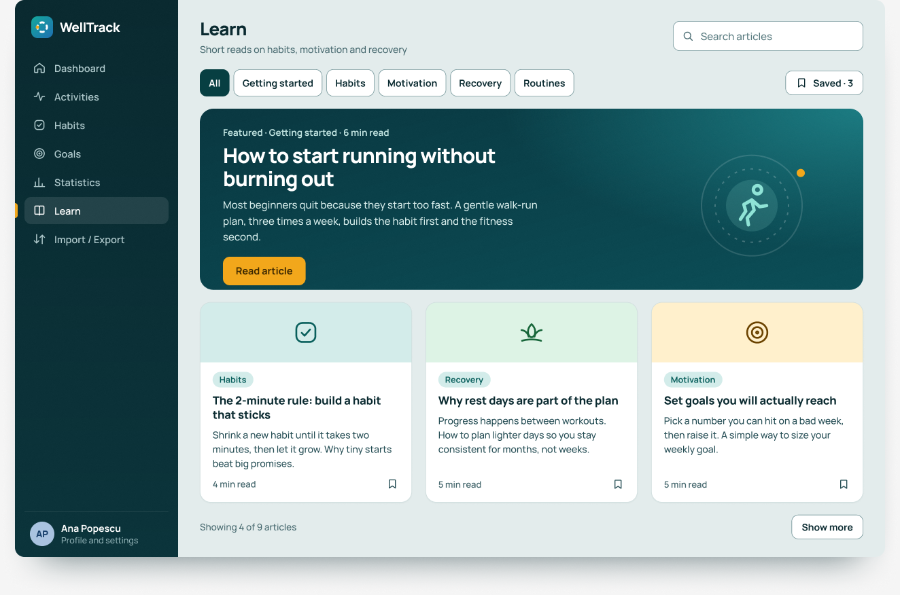

# Wireframe-uri WellTrack

Acest document descrie pe scurt ecranele aplicației WellTrack și modul în care utilizatorul navighează între ele.

Mock-up-urile complete sunt în Figma:
[WellTrack – Mockups (Etapa 2)](https://www.figma.com/design/BQSqsteCq8ny7kLWAGW6qG/WellTrack-%E2%80%93-Mockups--Etapa-2-?node-id=2-2&p=f&t=dOYK0zwEm1I63cRz-0)

Sunt **12 ecrane pentru desktop** (1280 × 820) și **7 ecrane pentru mobil** (390 px lățime). Textele din interfață sunt în engleză, așa cum apar în mock-up-uri.

## Cum este organizată aplicația

- **Desktop:** navigarea se face printr-un **sidebar în stânga**, prezent pe toate ecranele după autentificare. Sus are logo-ul WellTrack, apoi secțiunile *Dashboard, Activities, Habits, Goals, Statistics, Learn, Import / Export*. Secțiunea în care se află utilizatorul este evidențiată. Jos, în sidebar, se află numele utilizatorului, cu acces la *Profile and settings*. Conținutul paginii se afișează în dreapta sidebar-ului.
- **Mobil:** o bară jos, cu patru taburi: *Home, Activities, Goals, More*. Restul secțiunilor (Habits, Statistics, Import / Export, Learn, Profile) sunt în tabul *More*.
- **Administrator:** același sidebar, la care se adaugă o secțiune *Administration*, cu *Users* și *Articles*.

---

## Ecrane desktop

### 01 – Login
Pagina de intrare în aplicație. În stânga sunt câteva idei despre aplicație (de exemplu „Log activities in seconds”), iar în dreapta formularul de autentificare.
- Câmpuri: email și parolă (cu butonul *Show* pentru a vedea parola).
- Opțiuni: *Keep me logged in* și *Forgot password?*.
- Dacă datele sunt greșite, apare mesajul „Email or password is incorrect”.
- Link către crearea unui cont nou: *New to WellTrack? Create an account*.

### 02 – Dashboard
Prima pagină după autentificare. Arată pe scurt cum merge săptămâna.
- Salut și buton mare *Log activity*.
- Obiectivul săptămânii (de exemplu „5 of 6 workouts”) și un mesaj de încurajare.
- Un cerc de progres, în care partea completată cu verde arată cât din obiectivul săptămânii este realizat (83% în exemplu).
- Trei cifre: minute active, distanță și serie de zile consecutive.
- Grafic cu minutele active pe fiecare zi a săptămânii.
- *Today's habits*: obiceiurile de azi (2 din 5 bifate).
- *Recent activities*: ultimele activități, cu link *See all*.
- *Goals*: obiectivele în curs, cu link *Manage*.



### 03 – Activities
Lista tuturor activităților înregistrate (sport, plimbări etc.).
- Tabel cu: dată, tip de activitate, durată, distanță, intensitate.
- Căutare în notițe și filtre după tip și perioadă.
- Paginare (*Previous / Next*).
- Butoane: *Log activity* și *Import / Export*.
- Formularul **Edit activity** (fereastră deschisă peste listă): tip, dată, ora de start, durată, distanță (opțional), intensitate (*Light / Moderate / Hard*) și notițe. Se poate salva, anula sau șterge activitatea.

### 04 – Habits
Obiceiurile zilnice sau săptămânale (de exemplu „Drink 8 glasses of water”).
- Tabel cu zilele săptămânii (L–D), unde utilizatorul bifează ce a făcut, și un total (de exemplu 6/7).
- Butoane: *New habit* și *Show archived*.
- Formularul **Edit habit**: nume, frecvență (zilnic sau anumite zile). Un obicei poate fi arhivat.

### 05 – Goals
Obiectivele personale, cu progresul lor.
- Filtre: *Active / Completed / All*.
- Fiecare obiectiv are o bară de progres (de exemplu „Run 30 km in November – 15.1 of 30 km”).
- Când un obiectiv este atins, apare un mesaj de felicitare.
- Formularul **New goal**: nume, tipul de activitate numărată, țintă și unitate (de exemplu 100 km), perioadă (*Weekly / Monthly / Custom dates*) și data de start.

### 06 – Statistics
Grafice despre evoluția utilizatorului.
- Comutare între *Week* și *Month*.
- Minute active pe zi, comparate cu perioada anterioară.
- Rezumat „această săptămână vs. precedenta”: minute, sesiuni, distanță.
- Timpul petrecut pe fiecare tip de activitate.
- Câte obiective au fost atinse în ultimele 8 săptămâni.
- Calendar al lunii, în care culorile mai închise înseamnă mai multe minute active.



### 07 – Learn
Articole scurte despre obiceiuri, motivație și recuperare.
- Căutare și filtre pe teme (*Getting started, Habits, Motivation, Recovery, Routines*) și filtrul *Saved*.
- Un articol recomandat, sus, cu butonul *Read article*.
- Lista celorlalte articole, cu timpul de citire și butonul *Show more*.



### 08 – Article
Pagina unui articol.
- Titlu, timp de citire, data actualizării.
- Butonul *Save* pentru a-l salva și *Mark as read* pentru a-l marca citit.
- Cuprins lateral („In this article”) cu procentul citit.
- Notă că este informație generală, nu sfat medical.
- *Related reads*: articole asemănătoare.

### 09 – Import / Export
Mutarea datelor despre activități în și din aplicație, în format CSV.
- **Export:** se alege perioada și se descarcă fișierul CSV.
- **Format:** sunt afișate coloanele cerute (`date, type, duration_min, distance_km, intensity, notes`), limitele (maximum 1.000 de rânduri și 1 MB) și un fișier exemplu.
- **Import:** după alegerea fișierului, aplicația verifică datele și arată câte rânduri sunt bune și câte au erori (de exemplu „39 ready, 3 with errors”).
- Tabelul de erori arată rândul, coloana, valoarea și problema (de exemplu „Unknown type. Did you mean Swimming?”).
- Se poate descărca un raport de erori și se pot importa doar rândurile valide (*Import 39 rows*).

### 10 – Profile & settings
Gestionarea contului.
- **Account:** nume, email, prima zi a săptămânii (luni sau duminică).
- **Password:** schimbarea parolei (parola curentă, parola nouă de cel puțin 8 caractere, confirmare).
- **Your data:** *Export my data* și *Delete account*.

### 11 – Admin: Users
Pagina administratorului pentru conturi.
- Cifre generale: conturi totale, active în luna curentă, blocate.
- Tabel cu: utilizator, rol, status (*Active / Blocked*), data înscrierii, nr. de activități, ultima activitate.
- Căutare după nume sau email și filtre după rol și status.
- Buton *Export users CSV*.

### 12 – Admin: Articles
Gestionarea articolelor din secțiunea *Learn*.
- Cifre generale: articole totale, publicate, ciorne.
- Tabel cu titlu, temă, status (*Published / Draft*), data actualizării și numărul de citiri.
- Buton *New article*, căutare și filtre.
- Formularul **Edit article**: titlu, temă, timp de citire, rezumat, textul în Markdown și statusul. Articolul poate fi salvat sau șters.

---

## Ecrane mobil

| Ecran | Ce arată |
|---|---|
| **M1 – Dashboard** | Versiunea scurtă a dashboard-ului: obiectivul săptămânii (cerc cu procent), obiceiurile de azi și obiectivele în curs. |
| **M2 – Log activity** | Formular pe tot ecranul pentru o activitate nouă. Arată și o eroare: „Enter a duration between 1 and 600 minutes”. |
| **M3 – Dashboard (inactive days)** | Dashboard după 3 sau mai multe zile fără activitate: mesaj prietenos („A short one counts too”) și buton *Log activity*. |
| **M4 – Activities (empty)** | Lista goală pentru un cont nou, cu două acțiuni clare: *Log activity* și *Import from CSV*. |
| **M5 – More** | Meniul cu secțiunile care nu încap în bara de jos: Habits, Statistics, Import / Export, Learn, Profile and settings, Log out. |
| **M6 – Learn** | Lista de articole, cu teme care se derulează orizontal și un articol recomandat. |
| **M7 – Article** | Un articol, afișat pe o singură coloană, cu butonul *Mark as read*. |

---

## Fluxul de navigare

Fluxul de mai jos este dedus din butoanele și meniurile din mock-up-uri.

```
Login ──(autentificare reușită)──► Dashboard

Sidebar (stânga), vizibil pe toate ecranele de după Login:
┌──────────────────┐
│ Dashboard        │  → rezumatul săptămânii
│ Activities       │  → listă ─► Log activity / Edit activity
│ Habits           │  → listă ─► New habit / Edit habit
│ Goals            │  → listă ─► New goal
│ Statistics       │  → grafice (Week / Month)
│ Learn            │  → listă de articole ─► Article ─► Related reads
│ Import / Export  │  → export CSV / import CSV
│                  │
│ Ana Popescu      │  → Profile and settings
└──────────────────┘

Scurtături între ecrane:
- Dashboard: Log activity → formular; See all → Activities; Manage → Goals.
- Activities: butonul Import / Export → Import / Export.
```

### Fluxul principal: înregistrarea unei activități
1. Utilizatorul se autentifică pe **Login** și ajunge pe **Dashboard**.
2. Apasă *Log activity* (pe Dashboard sau în Activities).
3. Completează formularul (tip, dată, durată, intensitate) și salvează.
4. Activitatea apare în **Activities**, iar progresul din Dashboard și din **Goals** se actualizează.

### Alte fluxuri
- **Cont nou:** Login → *Create an account* → cont nou → Activities goală (M4) → *Log activity* sau *Import from CSV*.
- **Obiceiuri:** Dashboard (*Today's habits*) sau Habits → bifarea zilei → totalul se actualizează.
- **Obiective:** Goals → *Set a new goal* → completare formular → *Create goal* → obiectivul apare în listă și pe Dashboard.
- **Import CSV:** Import / Export → alegerea fișierului → verificare → corectarea erorilor sau *Import 39 rows* → activitățile apar în Activities.
- **Citit articole:** Learn → alegerea unui articol → Article → *Save* / *Mark as read* → articole asemănătoare.
- **Revenirea după pauză:** după 3 zile fără activitate, Dashboard-ul de pe mobil (M3) arată un mesaj de încurajare și duce direct la *Log activity*.
- **Administrator:** după autentificare, administratorul folosește *Users* (vede conturile și statusul lor, exportă lista) și *Articles* (creează, editează, publică sau șterge articole).
